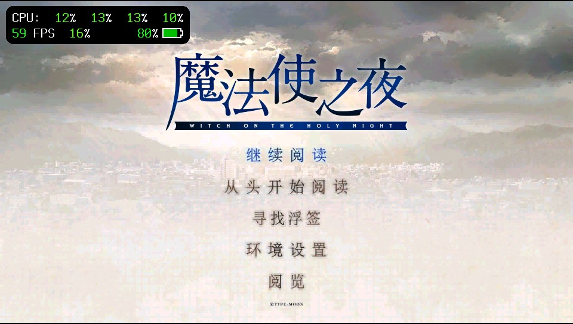
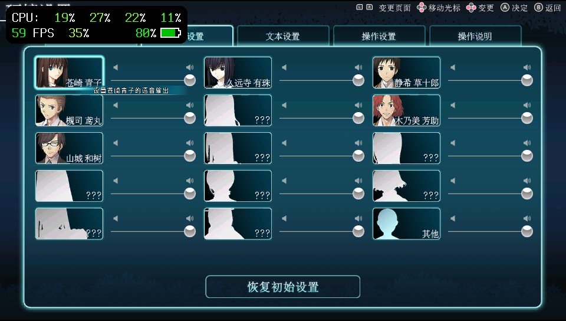
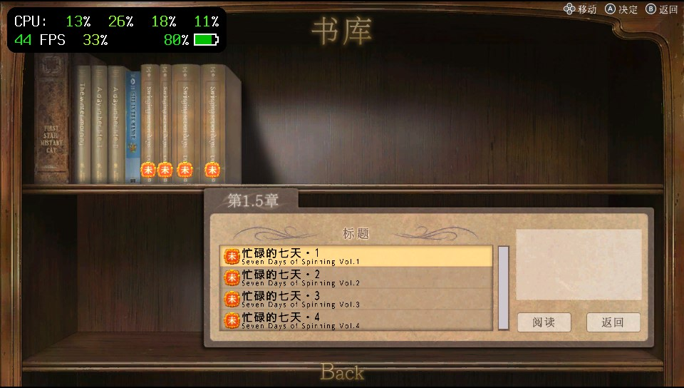
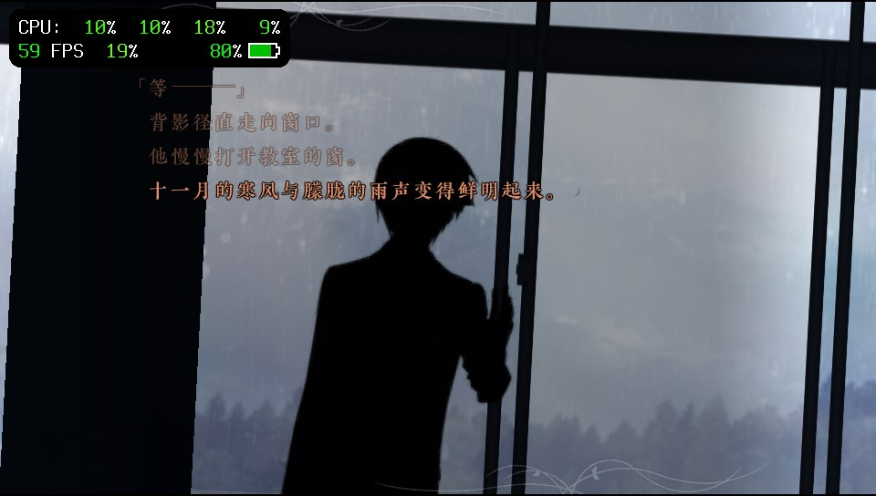

# mofa-vita · Witch on the Holy Night

**A native GXM engine port for PS Vita**

[](README.md)

[Technical documentation (Chinese)](doc/README.md) · [Optimization inventory (Chinese)](doc/05-优化记录与实测数据.md)

This project ports the [knife](https://github.com/AuroraWright/knife) 0.9.4 Rust engine to **native PS Vita GXM**, using user-supplied data from the Switch release of *Witch on the Holy Night*. Scenes and composition render at **960×540**, centered on the Vita's 960×544 display. The desktop WGPU backend remains available for development comparisons.

The repository contains engine sources, build tools, offline shaders and resource metadata. Game assets, fonts, audio, video and translation data must be supplied separately. **Building the engine does not require the full game asset pack.**

## Screenshots

| Title | Voice settings |
|---|---|
|  |  |
| **Archive** | **Story** |
|  |  |

Historical device screenshots; not performance acceptance evidence for the latest build.
## Current release and scope

The local package is **`stage-effect-r14-resource-guard-20261109`**, title ID **`KNIF00540`**. It uses the native540 memory-limited asset contract with r11 raw UI member access. The Vita UI is fixed to Chengkong Chinese, original language ID2; the asset pack retains English and Chinese. The default test profile is `hardware-test`, mask `0x7cfdfffffff`, with VitaDeck logging enabled.

r14 adds typed allocation-pressure recovery shared by frame uploads and story requests. If bounded recovery fails, it writes the last successfully presented resumable point to the automatic slot without rendering a menu. CONTINUE restores it; manual and quick-save slots are preserved. All 326 host tests and native fault-injection suites passed; this release still needs device validation.

r13 disables story-panel buttons 1, 2, 4 and 5 (previous scene, rewind, fast-forward and next scene), keeps them gray, and skips them during controller navigation. Auto playback, bookmarks, voice replay and internal save restoration remain available. It includes the r12 save/load focus fixes. With the r11 asset pack already installed, only the EBOOT or VPK needs updating. All 326 host tests passed; see the [installation guide](doc/08-素材与安装.md) for build receipts and device-validation limits.

## Implemented optimizations

- **Offline shaders selected by material across the game:** 85 embedded GXP programs, including complete programs for all 24 PS blend operations and specialized plain, Fill, NoAlpha, Haze and Group contracts. Unsupported combinations retain the complete fallback.
- **Less GPU work and safer submission:** native destination fetch, Group composition, bounded adjacent OP7 fusion, conservative composite bounds, compact vertex streams, dependency tracking and per-slot completion.
- **Bounded resource handling:** native DXT1/DXT5 upload, shared owners, bounded prefetch, grading/text/group caches, allocation recovery and safe GPU retirement.
- **UI member reads:** r11 preserves image bytes while avoiding the mandatory 16.75 MiB whole-atlas output allocation for DISP. Temporary allocation failures have bounded recovery.
- **Audio and UI stability:** approximately one second of BGM PCM buffering, gallery/library loading fixes, save/load target recovery and r12 focus fixes. Auto playback remains; player-triggered fast-forward is disabled on Vita.

The [optimization inventory](doc/05-优化记录与实测数据.md) lists all **43 switches**, fixes, defaults and evidence limits. The heaviest complete window in the r10 hardware log was approximately 12.75 FPS. This is **not a guarantee of 20 FPS throughout the game**. Enabled Half/Tiled/Blur experiments still require individual device image and performance validation.

## Build and install

Run from the repository root; Windows uses WSL. Vita builds use the pinned `nightly-2026-05-28` toolchain, rust-src and VitaSDK.

```bash
python3 tools/build-vita.py --check
python3 tools/build-vita.py game release
```

On Windows, `py -3` is also supported. Select a distribution with `--wsl <name>`. Set `KNIFE_BUILD_TAG` for each delivered build; keep `KNIFE_PERF_CONSOLE=1` and `KNIFE_VITA_QUIET=0` for logging. See the [build guide](doc/03-构建与工具链.md).

Install the local `dist/Witch-on-the-Holy-Night-Chengkong-540p-Vita/knife-vita-540p.vpk`, or stop the game and use VitaDeck to replace `ux0:app/KNIF00540/eboot.bin`. Put matching assets in `ux0:data/WitchontheHolyNight/assets/`.

**With r11 assets already installed, r12 only needs an executable/VPK update.** Older packs also need r11's `allui.hed`, `allui.mrg` and `vita-540p-assets.json`. The VPK does not contain these game assets. See [installation and hashes](doc/08-素材与安装.md).

Place `perf-enable.txt` and `optimization-profile.txt` in `ux0:data/WitchontheHolyNight/`, outside `assets/`. An explicit `0` disables logging; use `1` to enable it. Verify `build_tag` at startup. r12 emits `save_focus` only when selection state changes. See [logging and GPU replay](doc/06-性能采集与分析.md).


## Repository

| Path | Purpose |
|---|---|
| [knife/](knife/README.md) | Rust workspace, GXM backend and dependencies |
| [tools/](tools/README.md) | Build, asset preparation and validation |
| [doc/](doc/README.md) | Current technical documentation (Chinese) |
| `dist/` | One runtime pack and one editable PNG project, ignored by Git |
| `.work/` | Temporary output, diagnostic symbols and maintenance receipts, ignored by Git |

[Maintenance policy (Chinese)](doc/09-仓库维护与清理.md). Changes stay local unless explicitly authorized to push.

## Credits and licensing

Engine: [AuroraWright/knife](https://github.com/AuroraWright/knife), [MPL 2.0](knife/LICENSE), [upstream provenance](knife/UPSTREAM.txt). Third-party components retain their own notices and licenses under `knife/vita/vendor/`. Game content belongs to its respective rights holders and is not included.

[Credit artwork and update tools](tools/credit-intro/README.md).
