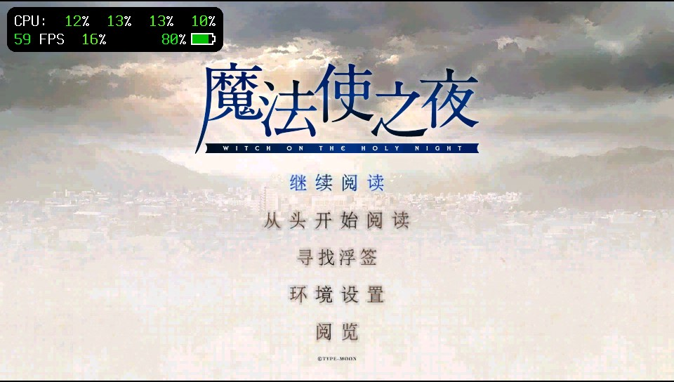
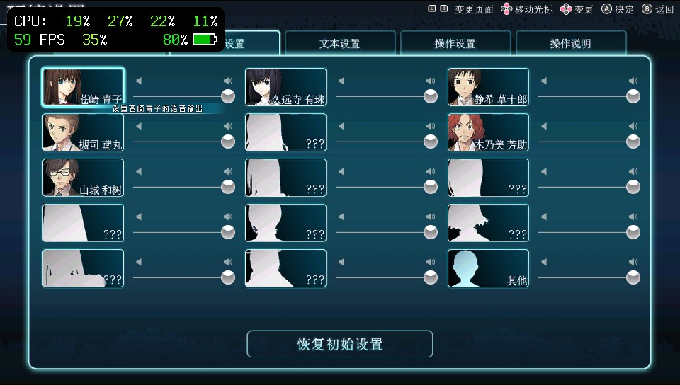
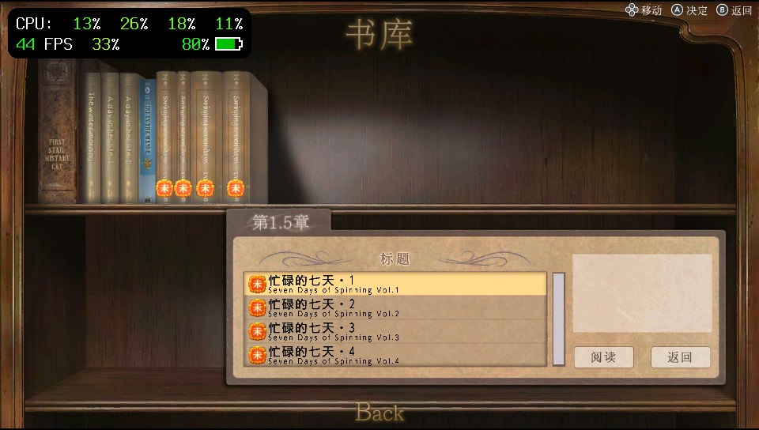
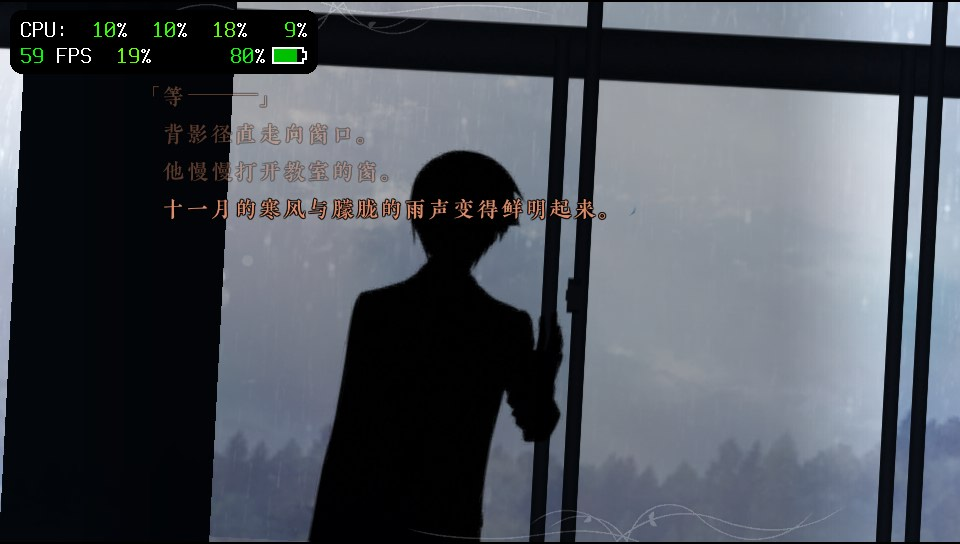

# mofa-vita · Witch on the Holy Night

**Native PS Vita GXM engine · 960×540 scenes and compositing**

[](README.md)

[Project website](https://atspwang618.github.io/myvita.github.io/mofa-vita/) · [Hardware demonstration](https://www.bilibili.com/video/BV1vUxn6nE59) · [Technical documentation](doc/README.md)

Based on [AuroraWright/knife](https://github.com/AuroraWright/knife) 0.9.4. The Rust engine reads Switch game data and renders through native GXM, centered on the Vita's 960×544 display. The desktop WGPU backend remains available for development.

The repository contains engine source, tools, shaders and metadata. Supply your own game images, fonts, audio/video and translation data. Building the engine does not require the complete game assets.

## Hardware screenshots

| Title | Voice settings |
|---|---|
|  |  |
| **Archive** | **Story** |
|  |  |

Historical screenshots are not performance acceptance evidence for the latest candidate.

## Current state

Final delivery assets: **70%-size PVRTC2 4bpp / DXT mixed pack**, `perf-render-20261117-r10-assets70-pvrtc2`. Converted from the existing 70% DXT pack without further resizing: 4.86 → 4.69 GiB (174.40 MiB / 3.51% saved). `release/` contains the paired executable. Hardware image quality and performance remain unverified. See [final-pack notes](doc/10-switch-asset-extraction.en.md).

On 2026-11-17, `perf/large_image@06415b5` was fully integrated into local `perf/render`. Previous integration baseline: **`perf-render-20261117-142048-06415b5-large-image-r10`**, title ID **`KNIF00540`**. See [release identity](doc/08-素材与安装.md).

- Native DXT1/DXT5 upload, offline color variants and KQTL large-image tiles. Unsupported material combinations retain a fallback texture.
- Material-selected specialized shaders, limited blend fusion, mask bounds and transparent-area rejection. Some optimizations require authenticated texture data or a specific scene phase; they are not universally applied.
- Bounded caches, GPU retirement, allocation recovery and protection of the last valid story checkpoint.
- Member-based UI reads, transition prefetch, dedicated save previews, packed Ogg audio and prepared BGM handoff.
- L+Square settings: 50%–150% story font size and rear-touch modes. Previous scene, rewind, fast-forward and next scene on the story panel are disabled; auto mode, bookmarks and voice replay remain available. Vita currently selects Chengkong Chinese; the asset pack retains English and Chinese.

Integration passed 469 host tests, ARM packaging and asset verification. New hardware image/performance/long-session validation is pending; no whole-game minimum FPS is guaranteed.

## Installation

1. Install `release/mofa-vita.vpk`, or close the game and upload `release/eboot.bin` to `ux0:app/KNIF00540/eboot.bin` using VitaDeck.
2. Copy the matching new `assets/` to `ux0:data/WitchontheHolyNight/assets/`. **The old r11 pack does not match this executable.** The new pack includes split image archives, `savethumb`, and audio banks.
3. Check the startup build tag, effective optimization profile and asset identity.

VitaDeck logging is enabled by default. `perf-enable.txt=0` in the data root disables performance logging. `optimization-profile.txt` replaces the entire default profile; an old `hardware-test` file does not enable all R10 additions. See [installation](doc/08-素材与安装.md) and [logging](doc/06-性能采集与分析.md).

## Build and assets

```bash
python3 tools/build-vita.py --check
python3 tools/build-vita.py game release
```

Requires VitaSDK, `nightly-2026-05-28` and rust-src; use WSL on Windows. The generic build defaults to `hardware-test`; use the environment settings in the [build guide](doc/03-构建与工具链.md) to reproduce the R10 configuration. Outputs are always `release/eboot.bin` and `release/mofa-vita.vpk`.

See the [one-command extraction and exact-replay guide](doc/10-switch-asset-extraction.en.md). Provide BASE, update 1.02, the Chengkong MOD, the custom logo and firmware fonts with this revision’s locked recipe and tools. Acceptance checks all 103 files against the historical SHA-256 baseline; execution evidence and scope are in [receipt 61](doc/evidence/61-source-exact-replay.json).

## Layout and licensing

[`knife/`](knife/README.md) contains the engine, [`tools/`](tools/README.md) the tooling, and [`doc/`](doc/README.md) current documentation plus versioned historical evidence. `release/`, `dist/` and `.work/` are local-only outputs. This checkout currently retains the runtime pack, not a complete editable PNG project. See [maintenance rules](doc/09-仓库维护与清理.md).

Engine license: [MPL 2.0](knife/LICENSE); provenance: [UPSTREAM.txt](knife/UPSTREAM.txt). Native dependencies retain their own notices. Complete game assets must be supplied separately. The exact-replay recipe includes explicitly identified historical encoding deltas; see its [scope and licensing notes](tools/source_replay/README.md). Thanks to @SpriteLisenLisen @DeQxJ00 @今何求 for technical support.
