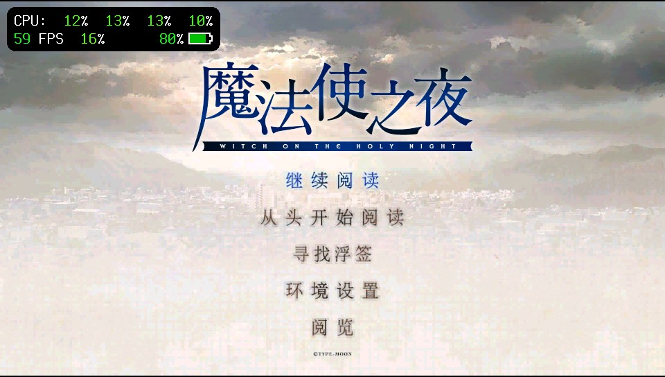
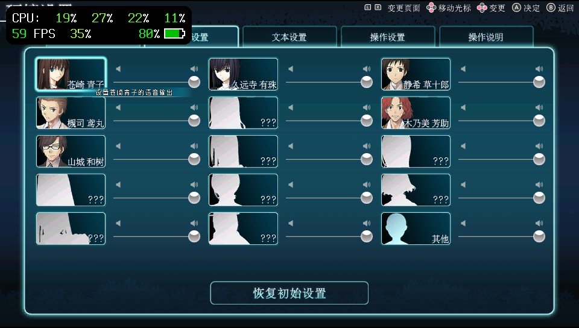
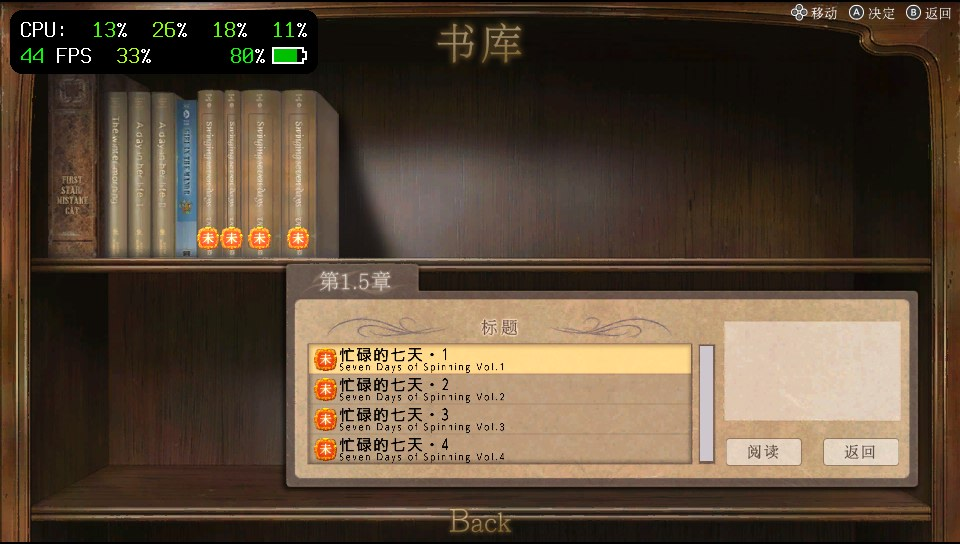
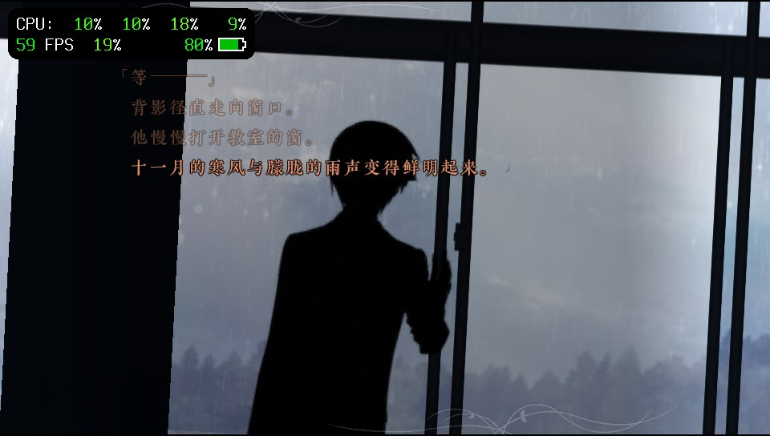

# mofa-vita · 魔法使之夜
- 项目官网介绍：https://atspwang618.github.io/myvita.github.io/mofa-vita/
- 实机演示：https://www.bilibili.com/video/BV1vUxn6nE59

**PS Vita 原生 GXM 移植引擎**

[](README.en.md)

[技术文档](doc/README.md) · [优化清单](doc/05-优化记录与实测数据.md) · [原版资源提取](doc/10-Switch原版资源提取.md)

本移植版本基于 [AuroraWright/knife](https://github.com/AuroraWright/knife) 0.9.4，将《魔法使之夜》Switch版的数据交由Rust引擎运行，图形使用Vita原生 **GXM**。场景与合成分辨率 **960×540**，居中输出至960×544屏幕。桌面WGPU后端保留供开发对照。

仓库提供引擎源码、构建工具、离线Shader和资源元数据；游戏本体、字体、图像、音视频及汉化数据须自行准备，不随源码分发。**编译引擎不需要整套游戏素材。**

## 实机截图

| 标题 | 语音设置 |
|---|---|
|  |  |
| **书库** | **剧情** |
|  |  |

历史实机截图，不作为最新版本的性能验收证明。

## 当前状态

| 项目 | 当前值 |
|---|---|
| 本地交付版本 | `stage-effect-r14-resource-guard-20261109` |
| 应用ID | `KNIF00540` |
| 素材合同 | native540离线显存限额 + r11 raw UI成员读取 |
| 界面语言 | Vita固定澄空中文ID2；资源保留英语/中文 |
| 优化配置 | `hardware-test`，mask `0x7cfdfffffff` |
| 日志 | VitaDeck默认开启，启动记录版本、有效配置和素材身份 |

r14新增统一纹理压力升级回收和有界重试；最终失败时，不经菜单/GPU将最近成功显示的有效进度写入自动槽，用“继续游戏”恢复。自动槽会更新，手动/快速槽保留。326项host测试及原生故障注入通过，实机复测待完成。详见[资源保护](doc/04-资源调度与缓存.md)。

r13将剧情顶栏第1、2、4、5项（上一场景、回退、快进、下一场景）固定为灰色并禁用，手柄导航自动跳过；自动播放、书签、语音及内部读档恢复保留。包含r12存读档焦点修复。**已装r11配套资源时，只需更新EBOOT或VPK。** 当前326项host测试通过；构建收据与实机验证边界见[安装说明](doc/08-素材与安装.md)。

## 已实施的主要优化

- **全游戏按材质选路的离线Shader**：85个GXP内嵌，包含全部24种PS混合完整程序、plain/Fill/NoAlpha/Haze精简入口及组混合入口。无需按章节预设，条件不符或程序不可用时回退完整路径。
- **减少GPU工作与同步**：native destination fetch、Group合成、有限相邻OP7融合、最终合成范围裁剪、紧凑顶点、依赖图和逐槽完成保护。
- **有界资源与缓存**：DXT1/DXT5原生压缩上传、共享owner、按需预取、调色/文字/组缓存、分配失败恢复及GPU使用结束后的释放。
- **大UI图集按成员读取**：r11保留图像字节，消除DISP必须整块申请16.75MiB解压输出的路径；临时失败可有界恢复。
- **音频与界面稳定性**：BGM约1秒PCM预读、书库/图录加载修复、存读档目标恢复、r12焦点修复；Vita保留自动播放，关闭玩家手动快进。

完整的 **43个开关、专项修复、默认状态与验证边界**见[优化清单](doc/05-优化记录与实测数据.md)。r10长日志最重完整窗口约12.75FPS；不能承诺全游戏20FPS。Half/Tiled/Blur等候选虽按要求默认测试开启，仍不等于已经完成逐项实机像素与性能验收。

## 游戏资源

请自行准备 Switch 原版游戏、本体对应的 1.02 更新及所需字体/汉化资源。提取步骤、命令和 Vita 转换要求见 [Switch 原版资源提取指南](doc/10-Switch原版资源提取.md)。

## 构建

从仓库根目录执行。Windows需要WSL；Vita构建固定`nightly-2026-05-28`、rust-src与VitaSDK。

```bash
python3 tools/build-vita.py --check
python3 tools/build-vita.py game release
```

Windows可使用`py -3`；指定本机发行版可加`--wsl pocket-ubuntu`。每次交付设置`KNIFE_BUILD_TAG`，默认保留`KNIFE_PERF_CONSOLE=1`、`KNIFE_VITA_QUIET=0`。详细依赖、探针、验证及产物说明见[构建文档](doc/03-构建与工具链.md)。

## 安装与日志

本地交付目录为`dist/Witch-on-the-Holy-Night-Chengkong-540p-Vita/`（不入Git）。安装`knife-vita-540p.vpk`，或关闭游戏后用VitaDeck将同名`eboot.bin`更新至`ux0:app/KNIF00540/eboot.bin`。

资源放`ux0:data/WitchontheHolyNight/assets/`

VPK不包含这些游戏资源。素材与成品SHA见[安装文档](doc/08-素材与安装.md)。

日志/配置文件位于`ux0:data/WitchontheHolyNight/`：`perf-enable.txt`显式1开启、0关闭；`optimization-profile.txt`可写`hardware-test`。启动核对`build_tag`。r12新增`save_focus`状态变化记录；字段与固定GPU回放见[日志文档](doc/06-性能采集与分析.md)。


## 仓库结构

| 路径 | 用途 |
|---|---|
| [knife/](knife/README.md) | Rust引擎工作区、GXM后端与依赖 |
| [tools/](tools/README.md) | 构建、素材制作与验证 |
| [doc/](doc/README.md) | 当前技术文档 |
| `dist/` | 唯一运行包及可编辑PNG工程，不入Git |
| `.work/` | 临时产物、诊断符号与整理收据，不入Git |

[仓库维护与清理规则](doc/09-仓库维护与清理.md)。未明确要求推送时，修改仅留本地。

## 来源与许可

引擎基于 [AuroraWright/knife](https://github.com/AuroraWright/knife)，沿用 [MPL 2.0](knife/LICENSE)，详情见[上游来源](knife/UPSTREAM.txt)。第三方依赖保留 `knife/vita/vendor/` 下的原许可与说明。游戏内容归各权利人所有，不随源码提供，特别感谢@SpriteLisenLisen大大给与这个项目的技术支持
