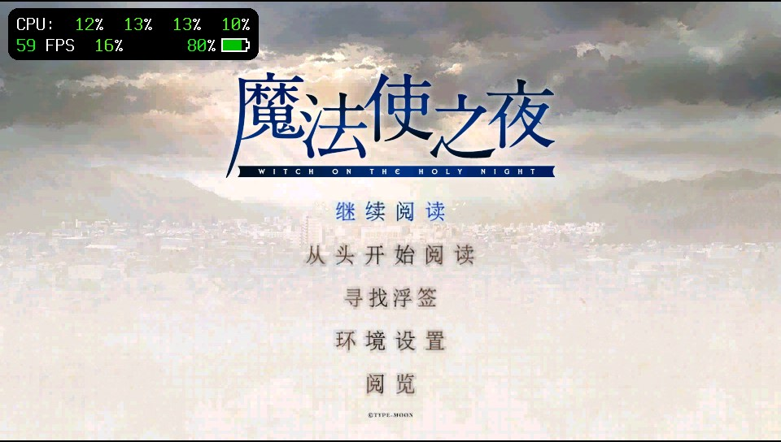
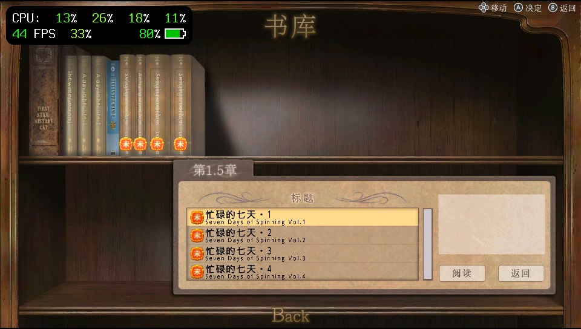
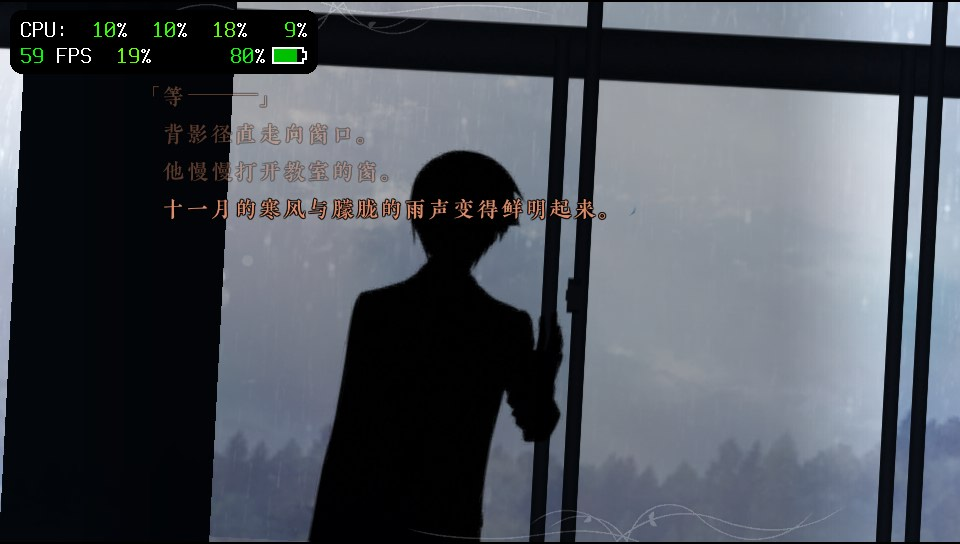

# mofa-vita · 魔法使之夜

**PS Vita 原生 GXM 移植引擎 · 960×540 演出与合成**

[](README.en.md)

[项目官网](https://atspwang618.github.io/myvita.github.io/mofa-vita/) · [实机演示](https://www.bilibili.com/video/BV1vUxn6nE59) · [技术文档](doc/README.md) · [优化清单](doc/05-优化记录与实测数据.md)

基于 [AuroraWright/knife](https://github.com/AuroraWright/knife) 0.9.4，以 Rust 引擎读取 Switch 版数据，使用 Vita 原生 GXM，在 960×544 屏幕上居中显示 960×540 画面。桌面 WGPU 后端保留作开发对照。

仓库提供引擎、工具、着色器及资源元数据。游戏图片、字体、音视频及汉化资源需自行准备；编译引擎不需要整套游戏素材。

## 实机截图

| 标题 | 语音设置 |
|---|---|
|  |  |
| **书库** | **剧情** |
|  |  |

截图来自历史实机运行，不代表最新候选包已完成性能验收。

## 当前版本

最终交付资源采用 **70%尺寸 PVRTC2 4bpp / DXT 混合纹理包**，版本 `perf-render-20261117-r10-assets70-pvrtc2`。以原70% DXT包为输入，不再缩小图片；资源4.86→4.69 GiB，节省174.40 MiB（3.51%）。`release/` 已配套更新，实机画质与性能待验证。见 [最终包说明](doc/10-Switch原版资源提取.md)。

2026-11-17 已将 `perf/large_image@06415b5` 完整整合到本地 `perf/render`。此前整合基线版本为 **`perf-render-20261117-142048-06415b5-large-image-r10`**，应用 ID **`KNIF00540`**。精确身份见[交付说明](doc/08-素材与安装.md)。

- 原生 DXT1/DXT5、离线调色变体及 KQTL 大图分块，保留逻辑坐标；复杂材质不满足条件时使用回退路径。
- 全游戏按材质选路的专用 shader，以及有限混合合并、遮罩范围和透明区域优化。部分优化依赖素材身份或特定演出阶段，范围见[优化清单](doc/05-优化记录与实测数据.md)。
- 有界缓存、GPU 生命周期保护、资源失败回收重试及最近有效进度保护。
- 图集按成员读取、转场预读、专用存档预览、Ogg 音频归档与 BGM 预备交接。
- L+□ 阅读/背板设置，剧情字号 50%–150%；书签栏上一场景、回退、快进、下一场景四项禁用；自动播放、书签与语音重播保留。

整合时 469 项宿主测试通过；ARM 构建、包检查及资源校验通过。新版本的实机画面、帧率与长期稳定性仍需验证，不承诺全游戏最低帧率。

## 安装

1. 使用 `release/mofa-vita.vpk` 安装；已有应用可关闭游戏后，用 VitaDeck 更新 `release/eboot.bin` 至 `ux0:app/KNIF00540/eboot.bin`。
2. 将配套新版 `assets/` 放到 `ux0:data/WitchontheHolyNight/assets/`。**旧 r11 资源不能直接配本版程序**；新版包含图片分卷、`savethumb` 和音频归档。
3. 启动核对日志中的 `build_tag`、有效优化配置及素材身份。

VitaDeck 日志默认开启，数据根目录中的 `perf-enable.txt=0` 可关闭。`optimization-profile.txt` 是完整配置覆盖；填写旧的 `hardware-test` 不等于启用新版 R10 全部选项。详见[安装](doc/08-素材与安装.md)与[日志](doc/06-性能采集与分析.md)。

## 构建与素材制作

```bash
python3 tools/build-vita.py --check
python3 tools/build-vita.py game release
```

构建使用 VitaSDK、`nightly-2026-05-28` 和 rust-src；Windows 通过 WSL 执行。通用构建缺省为 `hardware-test`，复现本次 R10 配置须按[构建文档](doc/03-构建与工具链.md)设置环境变量。输出固定为 `release/eboot.bin`、`release/mofa-vita.vpk`。

资源制作见[一键提取与精确复现指南](doc/10-Switch原版资源提取.md)。使用原版BASE、1.02升级、澄空MOD、定制logo及固件字库，配合本版本固定配方与工具重建最终包；验收必须通过全部103个文件的SHA。实际执行与边界见[复现收据61](doc/evidence/61-source-exact-replay.json)。

## 仓库结构

| 路径 | 用途 |
|---|---|
| [knife/](knife/README.md) | Rust 引擎、GXM 原生后端、构建依赖 |
| [tools/](tools/README.md) | 构建、素材处理及验证工具 |
| [doc/](doc/README.md) | 当前技术说明与有版本归属的历史证据 |
| `release/` | 最近正式程序与安装包，不入 Git |
| `dist/` | 本机配套运行资源，不入 Git；当前未保留完整 PNG 工程 |
| `.work/` | 当前符号、回退程序、验证记录与临时输出，不入 Git |

保留及清理规则见[维护说明](doc/09-仓库维护与清理.md)。默认仅本地修改，不自动推送。

## 来源与许可

引擎沿用 [MPL 2.0](knife/LICENSE)，来源见 [UPSTREAM.txt](knife/UPSTREAM.txt)。第三方依赖保留各自许可；完整游戏资源需自行提供。精确重建配方含明确标记的历史编码差分，权利说明见[配方说明](tools/source_replay/README.md)。感谢 @SpriteLisenLisen @DeQxJ00 @今何求 对项目的技术支持。
