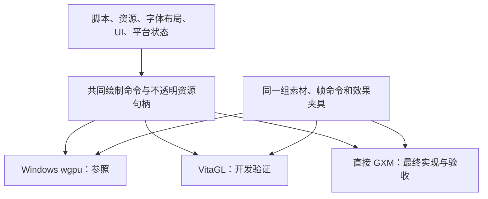

# 魔法使之夜：PS Vita 原生 GXM 移植实施计划与历史门槛

2026-10-28 当前状态：用户已把最终图片和场景目标改为 **480×270，拉伸到 960×540**，English/澄空双语。发布 VPK 已重新构建并接入 **SceJpeg 硬解优先、有界软件回退**；PNG 目前为有界 libpng，系统 PNG API 不能直接等同于专用硬件解码。图片工作线程固定一个，等待/已解码队列上限 8/2；复用归档句柄和索引读取。显式 GXM CDRAM 预算为 45 MiB，另留 JPEG 工作区 3 MiB、GXM 参数 16 MiB，策略总额仍 64 MiB。180 个当前构建源文件和 9 个产物有身份记录；英语、澄空的新包有限模拟器运行退出码均为 0，澄空记录到一次硬解路径成功。当前事实以 [270p 交付报告](../03-交付与实机/270p交付报告.md) 和 [图片、帧动画与真机测试](帧动画实机优化与测试.md) 为准。

以下 2026-10-27 的 540p 调查、测试数字和未完成门槛保留为历史记录；其中 48 MiB 预算、回想失败和旧 VPK 的 7,200 帧结果不能当成当前 270p 硬解版的回归结果。没有实机帧率、全剧情或所有菜单布局的验收结论。

修订日期：2026-10-27。状态：**直接 GXM DEV 游戏已完成 ARM 构建，并已静态分析 PCSG01127 官方 Artemis 的动画队列、离屏目标复用和显存池路径。本轮加入驻留计数/无压力快速路径、菜单/存档阶段目标释放和完整帧准入衔接；host 渲染测试 52/52 通过。相同新包的 7,200 帧真实手柄保存/恢复客体状态及文件验证通过，显式块 119 次分配/释放配对，但宿主关闭仍为 0xC0000374。回想首开仍因峰值需要 4 MiB、实际余量仅 2.75 MiB 失败，宿主为另一退出码 0xC0000005。CDRAM 跟踪峰值 48 MiB，未提高预算；整体运行、底色/模糊像素、完整剧情及真机未验收**。详见 [Artemis 调度与性能约束](Artemis官方引擎调度与性能约束.md)、[最新结构化记录](../vita-artemis-performance-review.json)、[存读档与内存调查](存读档与模拟器内存调查.md) 和 [DXT 实施记录](DXT纹理加载实施记录.md)。

基线为本机 knife 0.9.4，提交 `8de7f3b147e1c430fdfdc66af0ced7e79f8ab642`，本地分支 `work/woh-540p-chengkong` 及现有定制改动。全部改动留在本地，未提交或推送。路线继续为“VitaGL 可用于开发验证，最终直接调用 GXM”；原审查判断见 [审查采纳说明](GXM审查采纳说明.md)。

## 1. 目标和固定约束

一次完整实施按依赖顺序推进，交付可重复构建的原生 Vita 工程、VPK 和验证记录。“一次性”表示统一路线和完整验收，不能据此承诺一次构建成功。当前已进入实现和分项验证阶段；探针 VPK 证明其指定边界，不能代替完整游戏交付。

- 最终程序为原生 ARMv7，渲染直接调用 `sceGxm*`，显示通过 `sceDisplay*`。VitaGL 是开发阶段可移除的验证后端；最终不链接它，也不依赖运行时 shader 编译模块完成渲染。
- 当前内容画布和普通图片为 480×270 档，拉伸到 960×540。显示缓冲采用 960×544，内容位于 y=2，上下各 2 像素黑边；输入同步映射。脚本逻辑坐标仍为 1920×1080，物理 stride、分配大小和纹理 pitch 单独计算。
- 语言只有 English、中文（澄空）；脚本/存档 ID 保持 1/2，资源槽 0/1，旧 ID 0→英语、3→澄空；保留日语配音。
- Windows 参照保留现有 540p PNG/JPEG、Ogg Opus、H.264 MP4、MRG/HED/NAM。Vita 在独立目录按实际 alpha 和脚本用途实验 DXT1/DXT5；不引入 WebP、不恢复高清包，也不批量重新编码 JPEG。DXT 优先解决运行时解码和显存开销，不承诺降低磁盘体积。
- JPEG 当前优先 SceJpeg 硬解，格式、尺寸、预算或驱动不满足契约时回退 libjpeg-turbo；PNG 为有界 libpng，先正确展开 PLTE/tRNS。GXT codec 8 为 PC 离线编码并直接 GXM 上传，当前仅支持默认 Alter、无 CPU grade/raw/语言 strip 的明确用途；生产 270p 资源没有批量改为 GXT。数据纹理和 LUT 单独处理。
- Windows 保持可构建，作为脚本状态及渲染参照；最终性能与兼容性由直接 GXM 真机版本验收，Vita3K 只辅助。

## 2. VitaGL 开发边界

保留共同的 Quad、Vertex、纹理/目标和命令调用语义，平台实现负责各自的资源所有权。当前 `knife-render` 通过 `cfg(target_os = "vita")` 选择原生 Vita facade，桌面实现移至 `desktop.rs` 并保留原有 wgpu API；Vita 实现不依赖 wgpu/winit。游戏共用路径不应持有 GL/GXM 原始指针，桌面专用 API 仍由目标 cfg 隔离。



| 后端 | 用途 | 通过后的证据范围 |
| --- | --- | --- |
| Windows wgpu | 保持现有行为，生成确定性帧命令和参考图 | 仅所测桌面场景 |
| VitaGL 开发后端（可选，当前未实现） | 按需要验证基础贴图、文字、输入及平台集成 | 仅该开发配置中的功能；不能替代 GXM 验收 |
| 直接 GXM（当前实施主线） | 最终显示、shader、混合、效果、同步及资源生命周期 | 已有有限模拟器证据；每项真机验证后才能列为最终交付通过 |

若使用 VitaGL，仅覆盖基础绘制及明确选定的诊断场景，不先实现全篇所有演出。当前已直接推进 GXM，VitaGL 探针未实施，不作为现有原生工作的完成证明；下文保留其原定验收范围，采用该开发分支时再逐项验证。

应用已提供 `vita-gxm` feature，完整游戏构建显式启用；渲染 facade 仍通过目标 cfg 选择原生 GXM。`vita-vitagl` 和互斥后端选择器尚未实现，也没有自动回退到 VitaGL 的实现。开发包名称、TITLE_ID、日志、输出目录标明 DEV，复用同一份 assets；存档采用独立 DEV 路径。模拟器用 NTFS junction 避免复制整套资源，并无操作系统强制只读挂载。若以后增加可选 VitaGL，须显式隔离入口和依赖，最终包仍固定直接 GXM。

本机已有 VitaGL 头文件和静态库，但库的构建选项及真机运行尚未验证。本机头文件与当前上游 API 不完全一致，例如本机声明 `vglSetupDisplayRenderTarget`；必须匹配实际头文件和库。开发内存预算另计 circular pool（默认 32 MiB）等内部开销，不能用 VitaGL 峰值替代 GXM 预算。

使用运行时 Cg 编译时，需核查 VitaGL/vitaShaRK/SceShaccCgExt 及真机 `libshacccg.suprx`；不能假定固定管线没有该依赖。静态库存在不证明真机模块可用。若开发期采用离线 GXP，验证本机 `vglShaderGxpBinary` API；开发缓存或输出不可未经检查直接作为最终 GXM 产物。

## 3. 已核实的输入和工具

普通源图 35,007 张：PNG 31,527、JPEG 3,480，每张最多 960×540。外部音频 9,470 个 Ogg **Opus**，48 kHz；影片为 logo、英语片头、澄空片头共 3 个 MP4。运行时两张 960×1080 双语纵向条带，每语言视图仍为 960×540；不能误认为单语言高清背景或在未核对索引时直接删除。

最初审计为 [补充工具清单](../vita-review-toolchain-inventory.json) 和 [审计日志](../logs/vita-review-toolchain-inventory.log)，其中未发现着色器工具的结论仅代表当时搜索范围。当前实际构建以 [平台构建收据](../vita-platform-build.json)、[基础 GXP 收据](../vita-shaders-build.json) 和 [完整特效 GXP 收据](../vita-effects-shaders-build.json) 为准。WSL 为 `pocket-ubuntu`，SDK 为 `/opt/vitasdk`。

| 项目 | 2026-10-27 本机观察 | 实施动作 |
| --- | --- | --- |
| arm-vita-eabi-gcc | 15.2.0，已交叉编译及最终链接 DEV 探针 | 版本和输入哈希见构建收据 |
| vita-elf-create | 已执行 ELF→VELF | 保留含重定位的 ELF，另存 VELF |
| vita-make-fself / vita-mksfoex / vita-pack-vpk | 已生成 SELF、SFO、多个 DEV VPK | 包检查脚本读取 SFO、文件及导入，不等于完整游戏可运行 |
| CMake / Ninja / cargo-vita | 已安装；现有脚本使用 CMake STATIC 和 Rust/Cargo 最终链接 | 不建立第二套 C 可执行程序链接 |
| 默认 nightly | rustc 1.100.0-nightly，未带 rust-src | 不用浮动 nightly 交付 |
| nightly-2026-05-28 | rustc 1.98.0-nightly，匹配 rust-src；已实际 build-std 和完整游戏 ARM 链接 | 当前脚本固定该日期工具链；链接通过不代表游戏流程通过 |
| VITASDK 环境变量 | 原审计 shell 未设置；当前构建脚本显式设置 | `/opt/vitasdk`，记录环境和最终链接 map |
| GXM / Display / Ctrl / AvPlayer / Audio stub | 已安装；完整游戏已链接 GXM/Display/输入/线程/文件/AudioOut/AvPlayer | AudioOut 使用 `libSceAudio_stub.a`；[10:27 UTC 三片 source-view 有限探针（原证据目录 .work 已清理） 已通过 Vita3K，仍缺完整片头、听感及真机验收 |
| libpng / libjpeg / zlib / libopusfile / libopus | 已实际静态链接，PNG/JPEG 与 Opus 有限定探针结果 | ABI、错误释放、预算和输出范围见各项收据 |
| VitaGL / vitaShaRK / SceShaccCgExt 等静态库 | 已存在 | 开发路径；构建选项、运行依赖尚待探针 |
| psp2cgc | `D:/unity/PSVITA/sdk/host_tools/bin/psp2cgc.exe`，SDK 3.5.0 build 13276，可运行 | 已编译基础 VS/FS 和完整 1 VS+15 FS；记录固定参数/哈希，不复制或分发 Sony 编译器/模块 |

原计划概括“rust-src 缺失”过于宽泛，现纠正为默认 nightly 缺失、日期固定工具链已有且已用于交叉构建。平台/渲染库、字体/混音/存档等探针和完整游戏入口均已有 ARM 链接证据；各探针的通过范围仍须与完整游戏实际运行区分。

Rust 官方将 `armv7-sony-vita-newlibeabihf` 列为 Tier 3、静态链接目标，无预编译标准库，`std::process` 未实现。现有脚本已构建 std 并运行限定的 Rust/C ABI 探针。shader 使用离线 Cg→GXP，基础与完整特效产物均有源码/输出哈希；完整特效的 16 个入口两次编译摘要一致，记录 GXP 头、对齐及参数反射，运行探针也已调用 `sceGxmProgramCheck`。这些结果仍不能代替全部效果的像素比较和真机绘制。

## 4. 源码、链接和资源边界

现有实现按目标 cfg 隔离桌面依赖：`knife-render/src/lib.rs` 分发到 `desktop.rs` / `vita.rs`；`knife-audio` 的 Kira/CPAL 路径限定桌面，Vita 使用本地混音/输出；应用 Cargo 已排除 Vita 的 wgpu/winit、gilrs、GStreamer 依赖。普通 Game/Ui、输入和 DEV 有限帧入口已接入 VPK。BFSAR 按需读取，字形使用 1024×1024 R8 分页，菜单按钮 DXT5 和普通 CG codec8/DXT1 已在独立 stage 运行。Vita 菜单/存档共用两张目标，离开这两个阶段时释放；通用 blur scratch 在 ghost/choice/legacy defocus 首次使用时创建。7,200 帧真实手柄保存/恢复的选定状态和文件观察通过，回想首开仍显存不足。下一步先按阶段所有权和 pass 内容存活区间减少重叠目标，再评估有界复用池；不依靠更多 LRU 迭代或模拟器宿主 FPS 判断可运行性。字段工作集及官方参考限制见 [Artemis 审查](Artemis官方引擎调度与性能约束.md)。

当前实际文件如下，不再使用未创建的独立 `knife-render-vita` / `knife-render-vitagl` 包名表示完成情况：

| 路径 | 职责 |
| --- | --- |
| [knife/knife-render-api/src/lib.rs](../../knife/knife-render-api/src/lib.rs) | 共用 Quad/Shade/PsOp 等契约和 112 字节 Vertex |
| [knife/knife-render/src/lib.rs](../../knife/knife-render/src/lib.rs)、[desktop.rs](../../knife/knife-render/src/desktop.rs)、[vita.rs](../../knife/knife-render/src/vita.rs) | 目标 cfg 分发；桌面原实现保留；Vita facade 实现上传、裁剪、目标/效果及命令生命周期 |
| [knife/knife-platform-vita/src/gxm.rs](../../knife/knife-platform-vita/src/gxm.rs) | 原生 GXM FFI、线程所有权和纹理/目标句柄；不使用桌面 GPU 对象 |
| [knife/vita/gxm_backend.c](../../knife/vita/gxm_backend.c)、[effects_backend.inc](../../knife/vita/effects_backend.inc) | context、patcher、显存、场景、混合、绘制、显示、同步和释放 |
| [knife/vita/shaders/](../../knife/vita/shaders)、[compile-vita-shaders.ps1](../../tools/compile-vita-shaders.ps1)、[compile-vita-effects.ps1](../../tools/compile-vita-effects.ps1) | 基础/完整效果 Cg、已生成 GXP 头和可重复编译；参数反射见对应 JSON 收据 |
| [knife/knife-platform-vita/src/native.rs](../../knife/knife-platform-vita/src/native.rs)、[knife/vita/platform.c](../../knife/vita/platform.c) | Rust/C ABI、文件、单调时钟、分配及线程探针 |
| [knife/vita/image_decode.c](../../knife/vita/image_decode.c)、[image.rs](../../knife/knife-platform-vita/src/image.rs) | 有界 PNG/JPEG 完整解码、RGBA8 straight alpha、Rust RAII 和错误清理 |
| [knife/vita/audio_decode.c](../../knife/vita/audio_decode.c)、[audio_output.c](../../knife/vita/audio_output.c)、[knife-audio/src/vita.rs](../../knife/knife-audio/src/vita.rs)、[nopus_stream.rs](../../knife/knife-audio/src/nopus_stream.rs) | Opus/原生 Opus 流、有界混音、AudioOut 专用线程和电影 PCM 队列 |
| [knife/vita/movie_player.c](../../knife/vita/movie_player.c)、[movie.rs](../../knife/knife-platform-vita/src/movie.rs)、[movie/vita.rs](../../knife/knife/src/movie/vita.rs)、[movie_gxm.inc](../../knife/vita/movie_gxm.inc) | AvPlayer 文件/分配/事件回调、借用视频帧、直接 GXM YUV 纹理及影片 PCM；GPU 完成后才能继续取帧或控制播放器 |
| [knife/knife/src/vita_entry.rs](../../knife/knife/src/vita_entry.rs)、[vita_input.rs](../../knife/knife/src/vita_input.rs) | 复用普通 Game/Ui 的完整游戏入口、按键/触摸和 DEV 有限帧运行，不以探针替代游戏状态机 |
| [knife/knife/src/text.rs](../../knife/knife/src/text.rs)、[probes/vita-text/](../../knife/probes/vita-text) | 复用原字体布局/FontAtlas，限定 EN/ZC 字体和文字探针 |
| [knife/knife-platform-vita/src/storage.rs](../../knife/knife-platform-vita/src/storage.rs)、[save.rs](../../knife/knife/src/save.rs)、[savedata.rs](../../knife/knife/src/savedata.rs) | 保留存档格式，DEV/正式命名空间、事务替换和备份恢复 |
| [knife/vita/CMakeLists.txt](../../knife/vita/CMakeLists.txt)、[knife-platform-vita/build.rs](../../knife/knife-platform-vita/build.rs) | STATIC C 库和 SDK/codec 链接输入，Rust/Cargo 唯一最终链接 |
| [tools/build-vita.sh](../../tools/build-vita.sh)、[build-vita.ps1](../../tools/build-vita.ps1)、[check-vita-package.py](../../tools/check-vita-package.py) | 已存在的 WSL DEV 构建入口、ELF/VELF/SELF/SFO/VPK 生成和包审计 |

**最终 ELF 由 Rust/Cargo 链接。** CMake 不再链接另一份 ELF，不调用 `vita_create_self` 等宏生成竞争产物。启动路径、panic/abort、线程、堆及 FFI 释放方唯一，panic/异常不跨 C ABI；C 结构体与 Rust `repr(C)` 通过 32 位 sizeof/offset 探针核对。固定 Cargo.lock、Rust 完整版本、GCC、SDK 头文件/库哈希；若使用 cargo-vita 包装，也保持同一责任边界。

核心保留脚本/格式/状态。Vita 归档已采用 `File + Mutex` 和经检查的 64 位 seek，单条存储/解码各限 32 MiB，不整体 mmap 或解压数 GiB 数据；最坏的两个条目缓冲为 64 MiB，尚须另计元数据、解码器、分配器及调用方缓存。实际六份归档的 33,862 个有效条目已与桌面读取逐字节对照，另有 36 个 NOFILE 项；其范围见 [归档验证](../vita-archive-verification.json)。[BFSAR 按需读取](../../knife/doc/vita-bfsar-bounded-verification.json) 使 219,087,752 字节的 `witch.bfsar` 只常驻约 3,163,944 字节元数据，音效按需读取有界 FWSD/FWAV；超过现有 PCM 限额的长 FWAV 明确报错，不扩大为全游戏内存峰值证明。

不重排脚本引用。PNG/JPEG 基线完整解码图片，输入上限 32 MiB、宽≤960、高≤1080、像素最多 4,147,200 B，跟踪工作预算 4.25 MiB；完整双语条带解码不能被称为只占半幅内存。原逻辑坐标保留，实际内容 960×540，只转换一次；逻辑尺寸不是高清源图。UI 图集按 `allui` 条目和 Renderer 身份共享，deferred 驻留预算 32 MiB、编码源预算独立计算；headroom 和驻留预算充足时跳过候选扫描/排序。普通 CG codec 8 通过 worker 传递单个 KIMG Vec、Arc<Archive> 和精确条目索引，主线程注册 deferred GXT，缓存缺失有界重读，不长期保存编码 Vec；CPU grade/raw/strip 明确拒绝且无高清回退。RGBA 上传准入计源图与 Alter 目标同时存在的峰值，完整帧先 pin，缺失图集准入可衔接空闲 CG 回收；仅真实压力触发候选扫描，原生上传/bake 失败不重试。present 前创建的目标仍需单独约束。剧情预取限定后续 24 个 STCH/SCH2，跳转后丢弃窗口外待上传结果。详见 [纹理实施记录](DXT纹理加载实施记录.md) 和 [当前性能约束](Artemis官方引擎调度与性能约束.md)。当前字体 R8 页及实际 GPU 目标尺寸均不表示恢复高清素材。

外置 assets 与引擎版本绑定、缺目录/版本/损坏诊断及完整启动检查仍属于应用集成验收；安装时检查大小/哈希，日常启动避免重读全部约 4 GiB。脚本 ID、存档格式、语言回退和别名按对应夹具声明兼容范围；存档主机故障注入通过不等于真机断电持久性已经证明。

## 5. 分阶段执行与验收

以下保留 M0–M5 原验收项目及范围，未勾选真机、完整游戏或整阶段项目。当前状态是各门槛的部分证据，不是整阶段完成：

| 边界 | 当前可证结果及收据 | 尚缺/限制 |
| --- | --- | --- |
| 工具链、ABI、DEV 包 | [平台构建](../vita-platform-build.json)、[实际 SDK 运行](../vita-platform-runtime.json) 及 [最新游戏构建](../vita-game-build.json)；KNIF00010 的同包保存/恢复与回想结果、冻结及 VPK SHA 见 [当前审查](../vita-artemis-performance-review.json) | 使用独立内存计数诊断模拟器；保存宿主 0xC0000374，回想首开显存失败且宿主 0xC0000005，runtime_verified=false，真机未验 |
| 桌面与渲染 facade | [Windows codec8 历史回归](../vita-windows-cg-codec8-regression.json)：16 个 x64 PE、186 项测试通过；当前 knife-render 库 [52/52（原证据目录 .work 已清理），另有图片缓存/预取 14/14，Vita 依赖树无 wgpu/winit | Windows 结果早于最新目标生命周期 cfg 改动，此轮未重打 dist EXE/游戏窗口回归；CPU 测试非 GPU 像素等价，VitaGL 可选分支未实现 |
| 归档、PNG/JPEG、DXT | [归档](../vita-archive-verification.json)、[BFSAR 按需读取](../../knife/doc/vita-bfsar-bounded-verification.json)、[C 解码](../vita-image-decode-build.json) 有基线证据；[DXT 实施记录](DXT纹理加载实施记录.md) 记录真实 SDK 转换、调色板/tRNS、单条普通 CG 替换及 22,156 条归档验证 | codec 8 当前不支持 CPU grade/raw/strip；无原图 sidecar；不能批量套用，不保证节省磁盘；长 FWAV、真机峰值仍待验 |
| 基础 GXM、离屏 | [修复汇总](../vita-gxm-present-fix-verification.json) 保留 viewport/copy 边界；[生产颜色探针](../vita-ui-color-vulkan-disabled-display-comparison.json) 三幅 GPU 截图在 RGB tolerance 8 下均 0 坏像素；[Artemis 审查](Artemis官方引擎调度与性能约束.md) 记录官方复用/同步路径、当前阶段释放与完整帧准入 | 合成颜色探针宿主异常、gpu_verified=false；真实游戏底色/模糊未像素验收；回想首开需要 4 MiB 但仅余 2.75 MiB；其他效果、更多场景及真机未验 |
| 全部效果 | [离线编译/反射](../vita-effects-shaders-build.json)：1 VS+15 FS 两轮摘要一致；[实际运行](../vita-effects-vulkan-disabled-runtime.json) VPK `32347d29…` API/正常退出均通过；[原方程像素比较](../vita-effects-vulkan-disabled-display-comparison.json) 39 块、29,952 像素，0 超差，最大通道偏差 2/255，阈值仍为 4/255 | 只覆盖 24 PsOp、9 Blend、6 Shade 的均匀中心 RGB；文字、动态边缘、Blur/Rule/Transition/Alter 等像素、章节帧序及真机仍未完整验收 |
| 原字体与文字 | [字体验证](../vita-text-verification.json)、[文字运行](../vita-text-vulkan-disabled-runtime.json) 保留布局/ruby/斜体/描边范围；[字形分页冻结（原证据目录 .work 已清理） 使用 3 个 1024×1024 R8 页；最新读档后文字页 1 条/59 字符及揭示计数恢复 | 未比较完整文字像素/内容；长时字形页增长、游戏底色/模糊及真机未验 |
| Opus、AudioOut、混音 | [Opus/输出运行](../vita-audio-runtime.json)、[混音构建](../vita-audio-mixer-build.json)、[混音探针](../vita-audio-mixer-runtime.json) 有分项证据；[游戏媒体适配](../../knife/doc/vita-game-movie-verification.json) 与 [10:27 source-view 电影冻结清单（原证据目录 .work 已清理） 的 VPK `cdc21345…`：三片源 SPS 裁剪 960×544→960×540，有限 GXM 帧 fence/停关通过；Logo 311 视频帧、501,760 PCM 帧及自然 EOF；两个 opening 无内嵌音轨，有限暂停/恢复/停止 | 电影独立探针不证明 opening 全片 EOF、游戏中的音画同步、听感、像素等价或真机；seek 精确落点未由该探针判定 |
| 存档与整合 | [存档验证](../vita-storage-verification.json) 有 41 项主机故障测试；[本轮同包真实输入](../vita-artemis-performance-review.json)：12 次按键完成空槽 0 保存、pc50→56、读档回 50，文字页计数恢复，4,175,872 B 存档两次快照哈希一致；客体完成 7,200 帧，119 次显式块分配/释放配对 | runtime_verified=false：宿主 0xC0000374；48 MiB CDRAM 只为跟踪块峰值；多槽/取消/覆盖/重启恢复、像素、完整剧情、长时和真机未验 |

旧收据中的 API `RESULT PASS` 若伴随黑图、像素失败或异常关闭，不能计作画面或完整运行通过。历史 3,600 帧 CG 路线到 scene 1 pc125、IMG1227 DXT1 上传三次；该事实保留在 [历史汇总](../vita-dxt-cg-validation.json)。最新 7,200 帧存读档路线的 IMG1227 上传一次、菜单 DXT5 两次，所跟踪 CDRAM 105 分配/105 释放、峰值 48 MiB，非 CDRAM 14/14，结束无记录中的存活块。同包回想首开仍失败：第 2,296 帧需要 4 MiB、余量 2.75 MiB；95 次 CDRAM 分配/64 次释放为 panic 时快照，不作为泄漏判定。原版模拟器 SDK 六次释放均只回收计数 24 B，独立哈希锁定诊断副本已通过六次完整实际回收；原 EXE 未改。原版无客体的空闲关闭也复现 0xC0000374，异常栈含 Qt GUI 销毁路径，但最早破坏堆的写入仍未知；回想的 0xC0000005 不与其混同。保存客体自然停止且账本归零不能证明宿主堆完整。截图云层和英语文字可见，左侧底色及模糊未完成同一时点像素对照。各次 VPK、冻结及边界见 [调查](存读档与模拟器内存调查.md)，后续按 [Artemis 性能约束](Artemis官方引擎调度与性能约束.md) 先处理阶段工作集，再做实机计时。

### M0：公共工具链和原生 shader 两个门槛

- [ ] 保存 Windows 基线、本地差异及依赖收据；记录 Rust、GCC、SDK、工具及库哈希。
- [ ] 优先验证现有 `nightly-2026-05-28` 与 rust-src 的 build-std、edition 2024、Cargo.lock 和核心依赖，探针通过后固定。
- [ ] Rust→C ABI 探针覆盖 32 位布局、堆分配/释放、seek/read、时钟及线程；核对唯一 Rust 最终链接。
- [ ] 保留 ELF relocation；`vita-elf-create` 之前不得用 Cargo `strip=true` / `strip="symbols"` 删除所需重定位。由探针确定最终 strip 时机/选项。
- [ ] ELF→VELF→SELF，加 SFO/图标生成最小 VPK；读取 SFO，核验属性和导入。
- [ ] VitaGL 开发探针核验本机头文件/库及 shader 路径，记录真机运行模块；只解除开发后端门槛。
- [ ] 原生探针：最小 VS/FS GXP，直接 GXM 清屏并显示一个 PNG 和 JPEG，核验程序注册、参数、显示队列和真机结果。

当前已越过基础交叉构建和离线 GXP 编译门槛，多个 DEV VPK 已生成并有分项运行记录；M0 中真机绘制及可选 VitaGL 项仍未完成，因此不将 M0 或 M2 整阶段标为通过。

现有 DEV 构建入口示例（PowerShell 调用 WSL；构建探针，不代表完整游戏入口已完成）：

```powershell
powershell -ExecutionPolicy Bypass -File tools/build-vita.ps1 -Mode platform
powershell -ExecutionPolicy Bypass -File tools/build-vita.ps1 -Mode effects
```

### M1：共同接口、资源与 VitaGL 有限验证

- [ ] 抽离共同接口、迁移桌面调用；持续保持 Windows x64 workspace 回归（最新 186 项），另完成英语/澄空各 8 个有限场景，必要时添加覆盖新边界的夹具。
- [ ] 隔离 Vita 的桌面依赖，验证 seek 归档、语言视图、别名/旧 ID 回退、有界解码和错误传播。
- [ ] VitaGL 显示基础背景、透明人物、字体、裁剪及简单 alpha；同一帧命令可供 Windows/GXM 消费，未知效果不得静默忽略。
- [ ] 复用字体布局，验证两语换行、标点、ruby、字距；证实编译阻塞后才考虑替代库。
- [ ] 开发包验证 Ctrl/触屏、确认/取消、时钟、存档路径和基本音频；休眠恢复/帧同步在最终 GXM 包复核。
- [ ] 存档采用临时文件→flush→重命名及备份，使用隔离夹具；DEV 存档/配置独立，最终路径 `ux0:data/knife-woh/saves`。
- [ ] 记录已验证的平台功能和尚未验证的 GXM 功能，核查接口无 GL/wgpu 泄漏；不把完整 VitaGL 特效作为下一阶段前置条件。

### M2：直接 GXM 基础绘制、显示与实际内存账本

- [ ] 通过 M0 原生门槛后实现 context、ring、patcher、render target、sync object、display queue，跟踪每项分配/释放。
- [ ] 基线使用普通 `sceGxmInitialize` 默认 flags，计入默认 16 MiB Parameter Buffer。调整大小需复杂场景验证，头文件最小值 0x40000 不能当作游戏可用预算。
- [ ] `PB_LPDDR` 仅候选：本机头文件注明普通初始化只接受默认 flags，额外 flags 对应 `sceGxmVshInitialize`。须核对 stub/导入、普通应用可调用条件与真机结果，不能仅设置枚举就移除 CDRAM 计费。
- [ ] 显示面/纹理按实际 stride、块对齐、map/unmap 和 GPU 使用期记账；双/三缓冲由测量固定。不用的 depth/MSAA 不启用，所需内部存储仍要计入。
- [ ] 实现 RGBA8、字体 alpha、UV、色调、透明、裁剪、批绘、效果目标。960×540 居中于 960×544，原脚本逻辑坐标到物理坐标只转换一次。
- [ ] 固化 sRGB/线性、直通/预乘 alpha、通道顺序、mask/LUT 线性数据契约，检查人物/文字黑边。
- [ ] GPU 完成后退休纹理/目标，明确提交、显示回调、关闭与销毁依赖，不能在 Rust drop 时立即释放仍被读取的内存。
- [ ] VitaGL 与 GXM 分别测内存，GXM 账本通过后再设 LRU 上限，不沿用 32–40 MiB 固定配额。

### M3：全部演出和颜色语义

覆盖当前 1 个顶点入口、15 个 fragment 入口：sprite、noalpha、forcealpha、fill、text、rim_text、mono、nega、transition、rule、blur、alter、present、present_srgb、ps。

覆盖 10 个 Blend：Alpha、Add、Sub、Multiply、Screen、Opaque、Ps、Over、Footprint、MaskAlpha；24 个 PsOp：Add、Darken、Lighten、LinearBurn、Burn、Dodge、DodgeAlpha、Difference、DifferenceAlpha、Exclusion、HardLight、HardLightEx、Overlay、SoftLight、Sub、AddNoAlpha、SubNoAlpha、NoAlpha、Normal、DarkenColorAlpha、LightenColorAlpha、ScreenColorAlpha、MultiplyDst、Copy；8 个 Shade 及 Blur/Uv/FullAdd/White、软遮罩/LUT、haze、规则过渡与 target copy。

- [ ] 每项绑定源码、输入素材/帧命令、Windows 参照、pass 顺序、alpha/gamma、GXM 实现和真机结果。
- [ ] 目标色采样使用不同读/写目标轮换，禁止同纹理边读边写；按实际指令/寄存器/带宽限制拆 pass，保持顺序。
- [ ] 不支持项明确失败并记录差异，不静默改为普通 Alpha。
- [ ] 夹具覆盖透明边缘、描边、反色、mask、目标采样及颜色空间。普通贴图每通道≤2/255 为初始目标；模糊等单独解释阈值，同时比较位置、alpha、帧序与效果存在性。
- [ ] 最终只以直接 GXM 真机结果标通过；VitaGL 项目仍须复核。没有完整章节/流程记录不能声明全篇兼容。

### M4：AudioOut、Opus、AvPlayer 和时钟

- [ ] `sceAudioOutOutput` 为阻塞 API，使用专用输出线程；解码/混音/输出队列有界，渲染线程不等待音频或大型媒体解码。
- [ ] 48 kHz PCM 保留 gain/fade、loop/seek、单双声道、快进停声、backlog 重播与 BFSAR 音效。实际 Ogg 为 Opus，使用探针通过的 libopusfile/libopus 或对应解码器。
- [ ] 统计解码帧、成功提交 PCM 帧、队列、输出等待和 underrun。音频主时钟基于已接受帧数与测量延迟估计，函数返回时刻不等于扬声器已播放完毕。
- [ ] AvPlayer 明确分配/释放、纹理帧分配/释放、open/close/readOffset/size、事件回调；文件偏移/大小按 uint64，逐项验证 FFI。
- [ ] 三个实际 MP4 分别核验 profile/level、帧率、音轨和 init/add/start、拉音视频、seek/skip、EOF、stop/close；桌面可播不证明硬解兼容。
- [ ] 本机 AvPlayer 视频结构没有独立 pitch/format/plane 字段。适配层帧描述须来自已验证输出契约/探针，记录 YUV 排布、stride、矩阵、范围、色度采样，不虚构 API 字段。
- [ ] 明确 GetVideoData 帧的有效期和解码器复用时机。未证明可持有到 GPU 完成时，先有界复制到引擎缓冲，再上传/转换；不预先声称零拷贝，不编造头文件没有的逐帧 release API。
- [ ] 拉取电影 PCM 接入同一游戏混音/AudioOut 输出者，验证与 AvPlayer 当前时间、时间戳关系，避免重复输出。无音轨用单调时钟；暂停/seek/skip/恢复明确刷新队列/原点。
- [ ] 实际 MP4 不兼容时先确认限制，再单独决定最小修正，不批量重新压缩影片。

### M5：最终 GXM 真机验收与交付

- [ ] 实测内存/帧时间，至少 2 小时长时运行；核对章节切换、电影退出、反复读档、休眠后的资源增长。
- [ ] 真机覆盖 EN/ZC、开场、分支、存读档、设置、backlog、快进、自动、CG/音声鉴赏、电影播放/跳过和休眠恢复。记录机型/固件/时钟，优先 Vita 1000/2000，PSTV 有硬件再测。
- [ ] VPK 仅引擎、离线 GXP、图标、元数据、许可；复用 `ux0:data/knife-woh/assets`，提供部署/更新与缺少/不匹配诊断，避免每次重装复制约 4 GiB 素材。
- [ ] TITLE_ID 暂定最终 `KNIF00001`；当前平台探针为 `KNIF00002`、普通游戏 DEV 为 `KNIF00010`，其他探针使用各自 DEV ID。最终仍核查冲突及 SFO/安装，不能把探针 ID 当作游戏正式 ID。采用常见 4 字母+5 数字约定，不凭旧 `KNIFEWOH1` 外形就判定其必定非法。
- [ ] 最终审计链接 map、保留符号 ELF、输入库和 VPK：不链接 VitaGL，不调用开发 GL 接口，不残留为渲染引入的 vitaShaRK/SceShaccCgExt/taiHEN 依赖；直接 GXM/离线 GXP 有证据。仅搜索已剥离符号 eboot 的字符串不足以证明。
- [ ] 交付本地源码、复现说明、VPK/清单哈希、覆盖矩阵、真机结果及已知差异；未测/失败项保留。

原 21–40 个工作日是工具齐备时的早期粗估，**不再作为当前路线的工期承诺**。VitaGL 接口工作单独计成本；M0 确定依赖/着色器后重估构建工作，M2 确定内存/同步后重估特效/媒体工作。具体日期和完整兼容范围依据结果安排。

## 6. 内存、存储与性能

主内存按 256 MiB 基线，目标峰值≤220 MiB、预留≥36 MiB；CDRAM 按 64 MiB 上限，记录实际可分配量和碎片。当前 DEV 包显式设置并检查 SFO `ATTRIBUTE2=0`，没有继承 cargo-vita 默认 12；探针包启动不证明真机可分配量或完整游戏峰值。扩展模式单列属性、预算、真机条件，不能默认所有构建都有约 365 MiB。

**按实际内存池记账。** MAIN/LPDDR、CDRAM、其他实际 SDK 类型分别记录；视频是用途标签，不能虚构第三个物理内存池。每条含请求字节、对齐后字节、类型、映射、用途、所有者、峰值、释放时机；隐式分配用回调或可用量差值估计并说明局限。

以下是纠正漏算的**未测量候选布局**：stride=1024、高度=544、RGBA8，原始每面 2.125 MiB；若独立 CDRAM 块按 256 KiB 向上对齐，每面 **2.25 MiB**。1024 为例子中的选择，不是所有缓冲的硬件最低要求；显示、效果、媒体各按实际 API 计算。

| 用途 | 候选分配量 | 内存池/条件 |
| --- | ---: | --- |
| GXM Parameter Buffer | **16 MiB** | 默认计 CDRAM；移至 LPDDR 需通过专项门槛 |
| 3 个显示面 | **6.75 MiB** | 本例 3×2.25 MiB CDRAM；双缓冲为 4.5 MiB |
| 2 个效果颜色面 | **4.5 MiB** | 本例相同 padded 布局，实际纹理布局决定值 |
| 上述小计 | **27.25 MiB** | 未含 ring、素材、字体、媒体 |
| 默认 context ring 原始大小 | **2.640625 MiB** | vertex 2、fragment 0.5、VDM 0.125、fragment USSE 0.015625 MiB；各池及对齐另记，每 context 计费 |
| patcher、程序、RT 内部存储、同步/对齐 | 待测 | 实际分配，不能归零 |
| 贴图、字体、未退休旧纹理 | 由余量反推 | 按帧 pin、LRU、预取、GPU 完成后回收，不预设 32–40 MiB |
| 视频帧、转换面、上传暂存 | 回调/队列实测 | 分别记 MAIN/CDRAM，不假定 6–8 MiB 足够 |
| CPU 图像、归档、字体、音频、Rust 堆 | 有界并发 | MAIN 含当前/下一资源、seek/切换及错误清理峰值 |

若本例 ring 原始字节也全计 CDRAM，小计已 **29.890625 MiB**，尚未加各块对齐和其他项目；余量不全属于贴图，媒体/切换会与旧纹理退休重叠。撤回旧版固定给贴图 32–40 MiB 的承诺。GPU 可访问的 MAIN 缓冲亦须验证映射/性能，不能将所有 GPU 用途一概计为 CDRAM。

960×540 RGBA 原始约 1.98 MiB，JPEG 文件大小不等于解码/GPU 占用。不得一次加载 35,007 张图；复用压缩资源、预取、有界并行，及时释放 CPU 副本。Vita 纹理分流按实际 alpha 选择 DXT1/DXT5，保留字体、精细 UI、数据纹理及不兼容 grade 的基线用途。实际 IMG1227 由 36,115 B JPEG KIMG 增至 524,384 B codec8 KIMG，经 NX 封装后所在 MRG 实际净增 36 KiB；GPU 块为 512 KiB，原 RGBA 分配约 2 MiB 且曾需额外 Alter 目标。因此节省显存不能等同缩小安装包，实验独立重建 MRG 所需的额外磁盘空间也单独记账。双语条带完整 RGBA 解码约 3.96 MiB；字形使用 1024×1024 R8 分页，早期实测 3 页每页 1 MiB，所有页与媒体/效果/待退休纹理一起计峰值。

普通对话目标 60 fps、复杂演出至少 30 fps，统计 p50/p95/p99 帧时间、加载时延、内存峰值、待退休纹理、音频 underrun。以上是未来目标，当前无相应实测结果。

## 7. 构建、部署与完成定义

现有 [tools/build-vita.ps1](../../tools/build-vita.ps1) 在 `pocket-ubuntu` 调用 [tools/build-vita.sh](../../tools/build-vita.sh)，固定工具链、离线 GXP、C STATIC，由 Rust 唯一链接 ELF→VELF→SELF，再生成 SFO/VPK 并核验导入/属性/哈希。现有模式为 platform/gxm/image/effects/audio/pipeline/text/audio-mixer/game/movie/compressed/ui-color，DEV TITLE_ID 为 KNIF00002–KNIF00013，输出 `.work/vita/<mode>`。game 是普通 Game/Ui，最新包上限 **7,200 帧**；movie/compressed/ui-color 是各自边界的独立探针。模拟器用全新 DEV profile 和 NTFS junction 引用当前 540p/实验资源，启动前重新核对输入哈希。最新保存/恢复使用独立内存计数诊断模拟器、Vulkan 和 memory-mapping disabled；构建、显式环境变量及命令见 [复现入口](存读档与模拟器内存调查.md#6-复现入口)。原版模拟器保留，普通释放计数修正不等于整套模拟器通过；宿主正常退出、像素及真机门槛仍保留。

当前 Vita cfg、完整应用入口和 DEV 探针已直接调用 GXM；最终继续使用该原生路线，缺 shader、组件或资源不符就明确失败。VitaGL 只保留为可选开发方案，当前不是 DEV 构建依赖。部署检查版本/空间、复制后验证清单，相同哈希资源跳过，不制造第二套完整素材。M5 的最终 TITLE_ID 和正式交付须按原验收范围复核，不能把 DEV 探针或有限帧游戏运行当作正式游戏包验收。

完成标志：

1. 干净目录重建 ELF、VELF、SELF、SFO、VPK，不依赖高清包或 VitaGL 开发库。
2. 二进制及链接记录证明直接 GXM/Display、离线 GXP，无渲染运行时编译依赖。
3. 两语、540p 图、音视频、存档、输入、演出均有对应真机记录，未完成项列明。
4. 实测内存/帧时间达预算，切场景、电影退出、休眠恢复无持续增长；全流程未测不能声明全篇兼容。
5. 交付安装/部署/按键/已知问题/许可/复现说明；源码 ZIP 不含游戏密钥、NSP、个人存档。

## 8. 依据

- 本机内容/Windows 证据：compact-bilingual-optimization.json、compact-current-integrity.json、compact-verification.json、compact-en-verification.json；不构成 Vita 运行证据。
- [补充工具审计](../vita-review-toolchain-inventory.json)、[日志](../logs/vita-review-toolchain-inventory.log) 保留为历史；后续工具定位、实际编译/运行以第 5 节对应收据为准。
- 当前目标隔离：[渲染分发](../../knife/knife-render/src/lib.rs)、[应用 Cargo 条件](../../knife/knife/Cargo.toml)、[音频依赖](../../knife/knife-audio/Cargo.toml)；应用集成正在推进。
- [Vita3K GXM 已定位限制](../vita-vita3k-gxm-defects.json)：CPU 表面读回及部分配置的关闭缺陷，不能用 API 返回或失真的 CPU backing 代替截图/真机验证。
- [Rust 官方 Vita 目标](https://doc.rust-lang.org/rustc/platform-support/armv7-sony-vita-newlibeabihf.html)：标准库及平台限制。
- [cargo-vita README](https://github.com/vita-rust/cargo-vita/blob/master/README.md)：ELF/VELF/SELF、relocation、SFO 默认属性。
- [VitaSDK GXM](https://github.com/vitasdk/vita-headers/blob/master/include/psp2/gxm.h)、[AvPlayer](https://github.com/vitasdk/vita-headers/blob/master/include/psp2/avplayer.h)、[AudioOut](https://github.com/vitasdk/vita-headers/blob/master/include/psp2/audioout.h)：以本机头文件和真机结果固化条件。
- [VitaGL README](https://github.com/Rinnegatamante/vitaGL/blob/master/README.md)、[GXM 初始化源码](https://github.com/Rinnegatamante/vitaGL/blob/master/source/gxm.c)：开发参考，不将 system app 选项推断为普通应用已验证可用。
- [VitaSDK samples](https://github.com/vitasdk/samples)、[libvita2d 原生 GXM 实现](https://github.com/xerpi/libvita2d/blob/master/libvita2d/source/vita2d.c)：平台/生命周期参考。

路线、预算布局和阶段安排属于工程判断；工具、头文件、静态库存在不证明指定 shader、影片或演出已经兼容。
